<div align="center">


# Hermes

### Your own agent. Right at home.

A native iPhone, iPad and Mac app for the [Hermes Agent](https://github.com/NousResearch/hermes-agent) you run.<br>
Watch every step it takes, hand it real work, and give each profile a face, a memory and one chat that never resets.

[](#install)
[](#install)
[](https://github.com/vburojevic/hermes-releases/releases/latest)
[](#architecture)
[](LICENSE)

<br>

[](https://testflight.apple.com/join/CVhbq8Ur)
&nbsp;
[](https://github.com/vburojevic/hermes-releases/releases/latest/download/Hermes.dmg)
&nbsp;
[](https://hermesapp.dev)

<br>

<picture>
  <source media="(prefers-color-scheme: dark)" srcset=".github/images/hero-dark.png">
  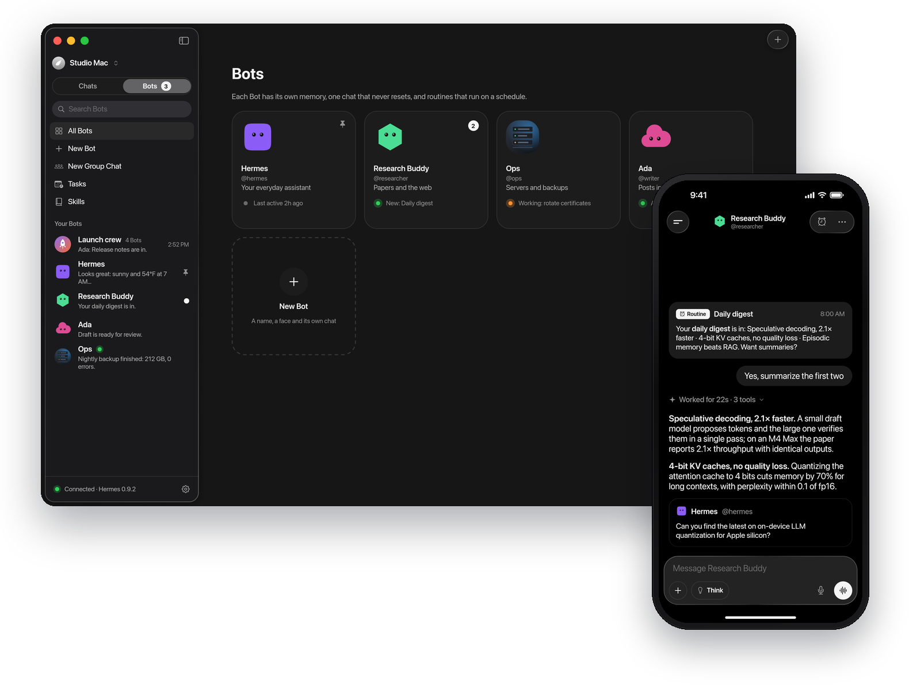
</picture>

</div>

<br>

> [!NOTE]
> **Hermes is in public beta.** It's used every day, but expect rough edges and changes between
> builds. Found a bug? [Open an issue](https://github.com/vburojevic/hermes/issues/new?template=bug_report.yml).
> Ideas and questions go in [Discussions](https://github.com/vburojevic/hermes/discussions).

## What is Hermes

[Hermes Agent](https://hermes-agent.nousresearch.com/) is the open-source agent by Nous Research that
lives on your own computer: it runs commands, writes code, browses, remembers what it learns and works
on a schedule. **Hermes** puts it in your hand. It talks only to your own Hermes, with no account and
nothing in between.

**Contents:** [Features](#features) · [Get started](#get-started) · [Install](#install) · [Privacy and security](#privacy-and-security) · [Build from source](#build-from-source) · [Architecture](#architecture) · [Roadmap](#roadmap) · [Contributing](#contributing) · [Community](#community) · [Security](#reporting-a-security-issue) · [License](#license)

## Features

<table>
  <tr>
    <td width="50%" align="center" valign="top">
      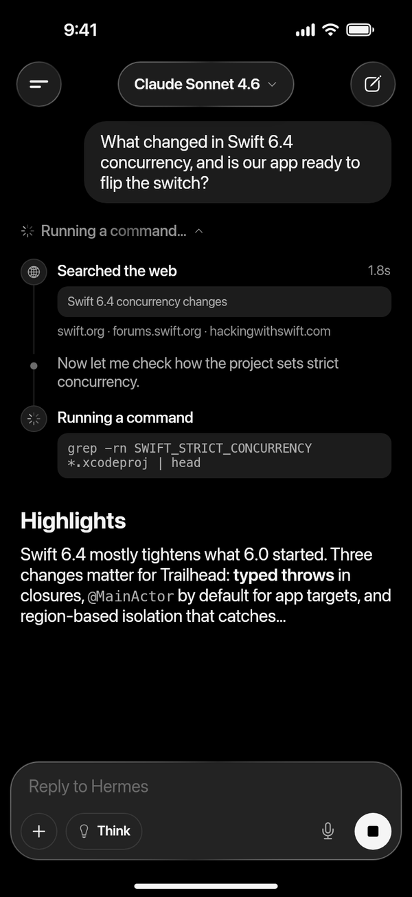
      <p><b>Watch it work.</b><br>Replies stream in with every search, command and file change, as it happens.</p>
    </td>
    <td width="50%" align="center" valign="top">
      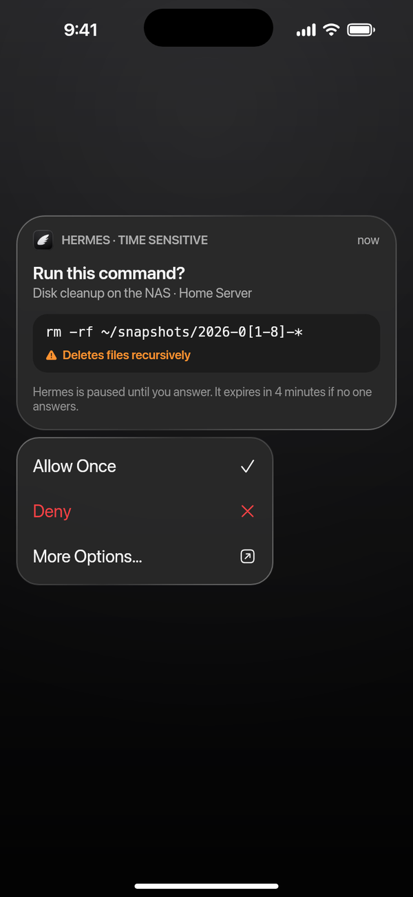
      <p><b>Answer from anywhere.</b><br>Allow a command from the Lock Screen, follow a turn in the Dynamic Island.</p>
    </td>
  </tr>
  <tr>
    <td width="50%" align="center" valign="top">
      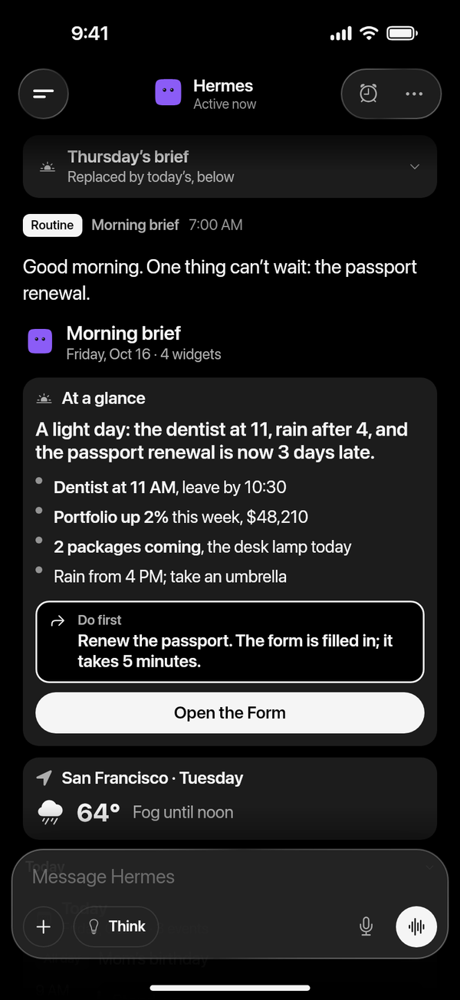
      <p><b>Replies you can tap.</b><br>When a card is clearer than a paragraph, Hermes sends one.</p>
    </td>
    <td width="50%" align="center" valign="top">
      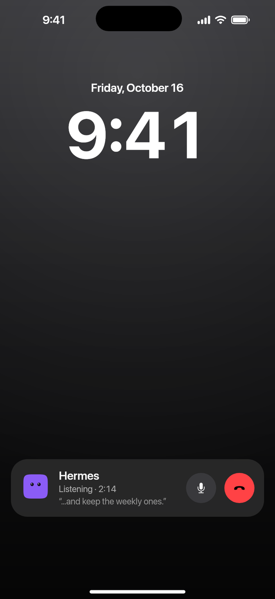
      <p><b>Just talk.</b><br>Hold to send a voice message, tap to talk. Each Bot speaks in its own voice.</p>
    </td>
  </tr>
</table>

<table>
  <tr>
    <td width="50%" align="center" valign="top">
      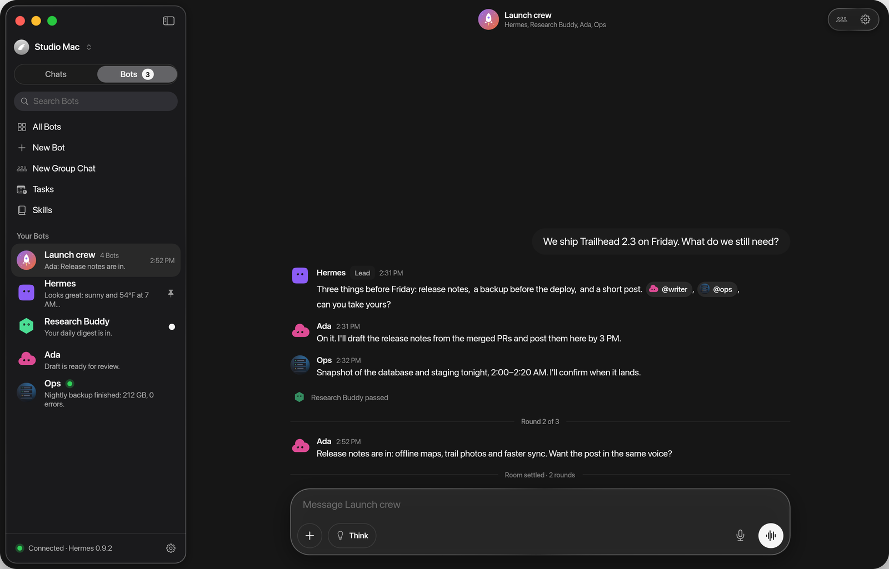
      <p><b>Every profile is a Bot.</b><br>Its own face, memory and one chat that never resets. Routines that report back, @mentions and group chats.</p>
    </td>
    <td width="50%" align="center" valign="top">
      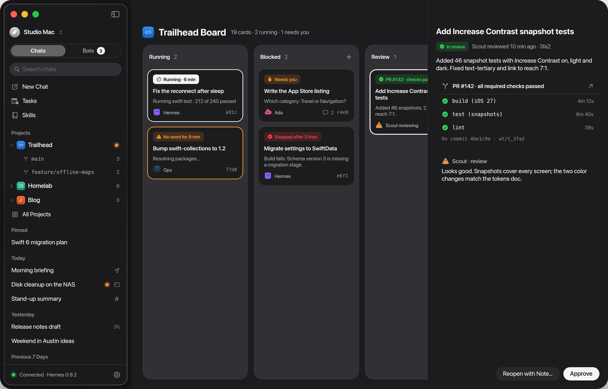
      <p><b>Hand it the work.</b><br>Put cards on a project's Board and Hermes and its Bots work through them, with checks and reviews.</p>
    </td>
  </tr>
  <tr>
    <td width="50%" align="center" valign="top">
      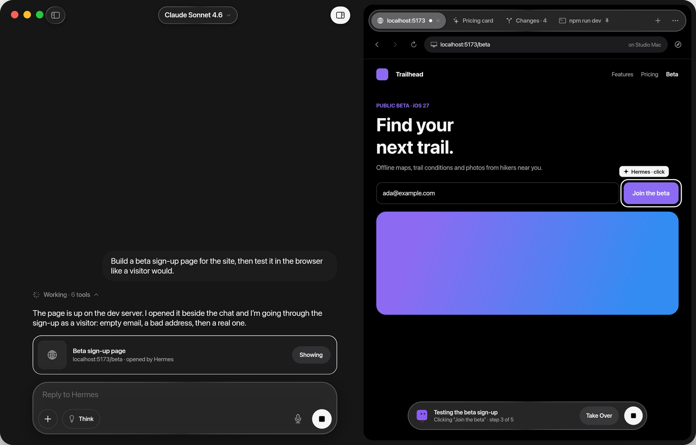
      <p><b>Watch it happen.</b><br>The Inspector opens beside the chat: the page Hermes is building, files and diffs, the terminal.</p>
    </td>
    <td width="50%" align="center" valign="top">
      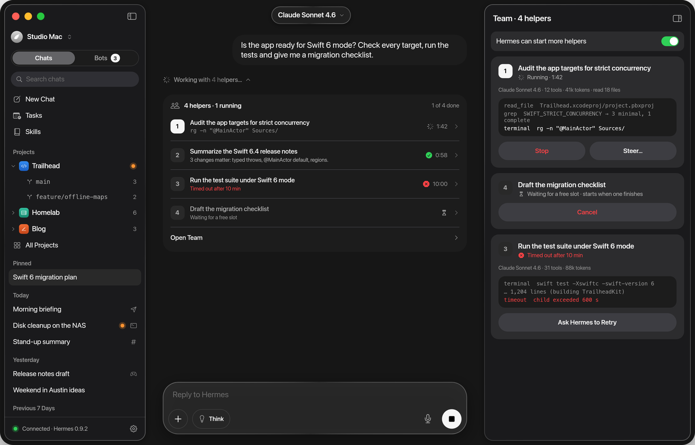
      <p><b>Follow the helpers.</b><br>See the team Hermes brings in, live, and stop or steer any of them.</p>
    </td>
  </tr>
</table>

**And the rest:** steer or queue a follow-up while Hermes works, and undo any turn that changed files.
Projects group chats by folder and branch. Read and edit what Hermes remembers about you, and see the
skills it wrote for itself. Search everything that was said. A drawer on iPhone, a split view on iPad,
menus and shortcuts on the Mac, with Dynamic Type, VoiceOver and Reduce Motion throughout.

<details>
<summary><b>More screenshots</b></summary>

<br>

<table>
  <tr>
    <td width="33%">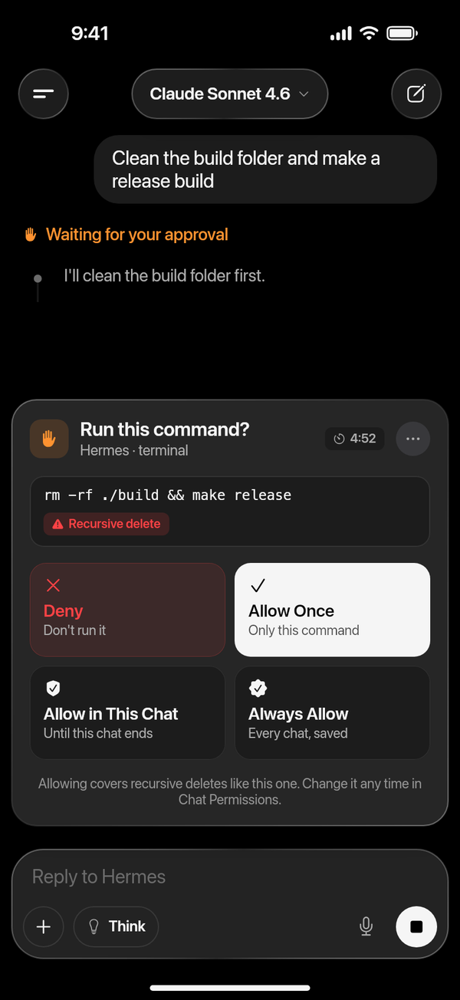</td>
    <td width="33%">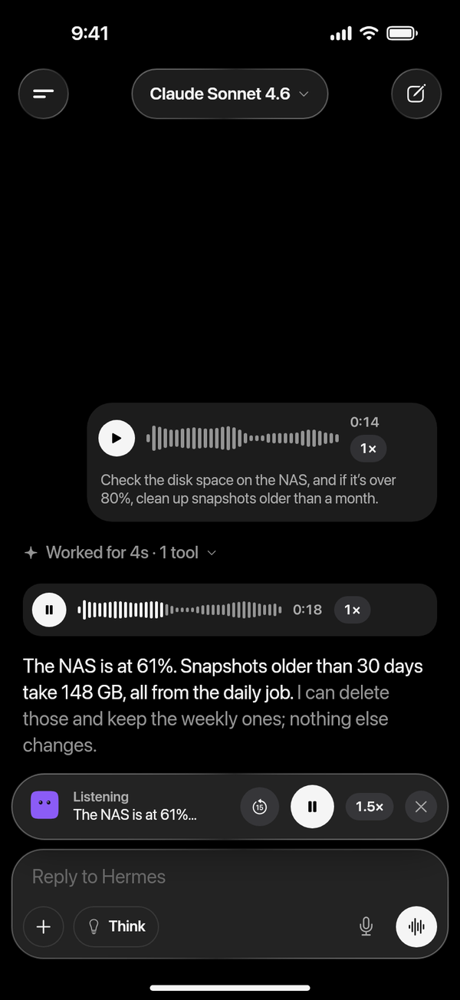</td>
    <td width="33%">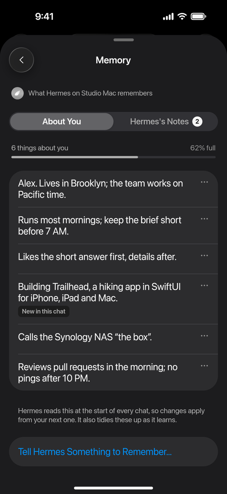</td>
  </tr>
  <tr>
    <td align="center"><sub>Approvals in the chat</sub></td>
    <td align="center"><sub>Voice messages and Listen</sub></td>
    <td align="center"><sub>Memory you can read</sub></td>
  </tr>
</table>

<table>
  <tr>
    <td width="50%">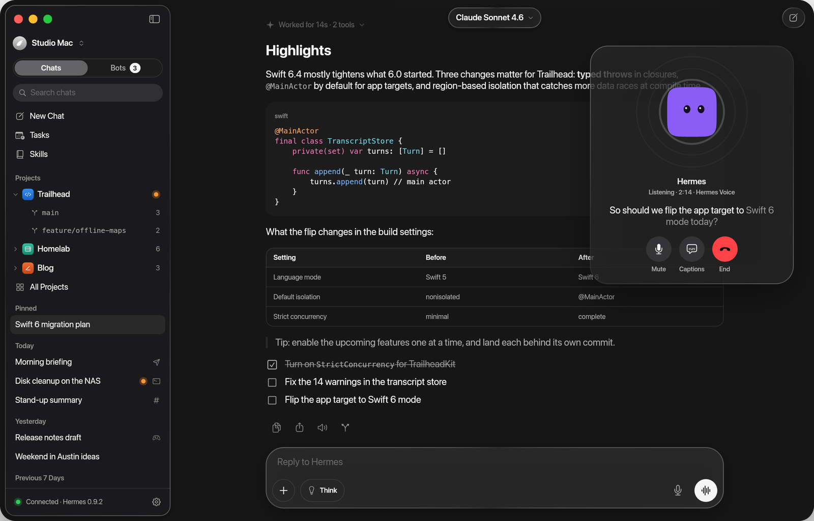</td>
    <td width="50%">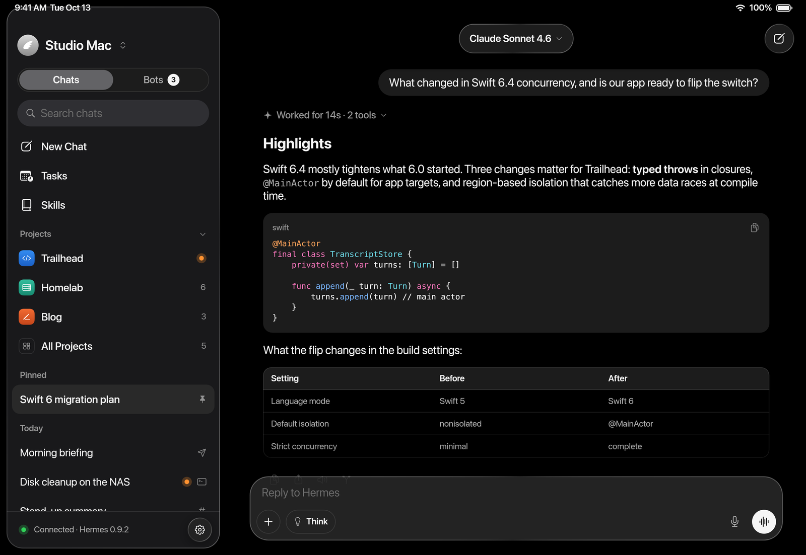</td>
  </tr>
  <tr>
    <td align="center"><sub>Talk on the Mac</sub></td>
    <td align="center"><sub>iPad</sub></td>
  </tr>
  <tr>
    <td width="50%">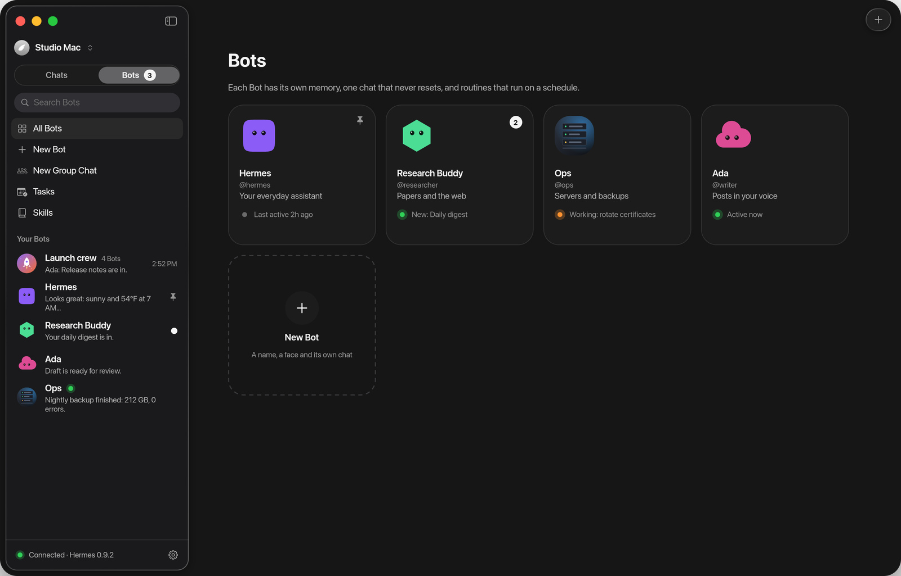</td>
    <td width="50%">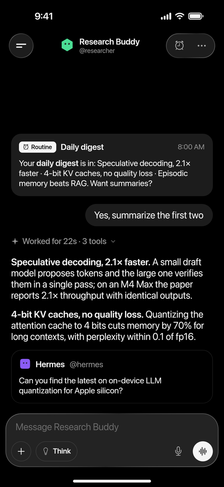</td>
  </tr>
  <tr>
    <td align="center"><sub>Your Bots</sub></td>
    <td align="center"><sub>A routine that reports back</sub></td>
  </tr>
</table>

</details>

## Get started

You need:

- **Hermes Agent** on a computer you control, with its API server on: a Mac, a home server or any
  machine you run. Follow the [install guide](https://hermes-agent.nousresearch.com/docs/) if you
  don't have it yet. Chats, tasks, skills and models need nothing more.
- **`hermes serve`**, Hermes's backend (Hermes Desktop starts it too), for **Bot Mode**: Bots and group
  chats, projects, the Board, the Inspector, memory, undo, "/" commands, sending files, search and voices.
- **The app's Hermes plugins**, for notifications on iPhone and iPad and for widgets. The app offers
  them once Bot Mode is linked, and installs them for you ([details](#the-apps-hermes-plugins)).
- **A way to reach it** from your other devices: the same network, or [Tailscale](https://tailscale.com)
  when you're out.

Not sure what's missing? **Settings → Setup** lists every feature as ready, partly set up or not set
up, with a fix or the exact steps.

## Install

| Device | Get it |
|---|---|
| **iPhone and iPad** | [Join the public beta on TestFlight](https://testflight.apple.com/join/CVhbq8Ur). iOS and iPadOS 26 or later. |
| **Mac** | [Download the Mac beta](https://github.com/vburojevic/hermes-releases/releases/latest/download/Hermes.dmg): signed, notarized, and it updates itself. macOS 26 or later. |
| **App Store** | After the beta. |

Then connect it to your Hermes:

1. **Turn on Hermes's API server.** On the computer running Hermes, add these lines to `~/.hermes/.env`,
   then run `hermes gateway restart`:

   ```bash
   API_SERVER_ENABLED=true
   API_SERVER_KEY=<a long random key, 16+ characters>
   API_SERVER_HOST=0.0.0.0   # so your phone can reach it; keep it to a network you trust
   ```

2. **Connect.** On the Mac running Hermes, open the app: it finds Hermes and connects in one click.
   On iPhone and iPad, scan the pairing code from the Mac app (**Pair a Device…**), or enter
   `your-mac.local:8642` and your key. Away from home, use its [Tailscale](https://tailscale.com)
   address.
3. **Turn on the extras.** For Bots, projects, the Board, the Inspector, memory and undo, also run
   `hermes serve` and link it in the gateway's settings. The app then offers its plugins, like
   notifications, and installs them for you.

Each build's changes are in [Releases](https://github.com/vburojevic/hermes/releases) and the
[CHANGELOG](CHANGELOG.md).

### The app's Hermes plugins

Hermes Agent can't reach Apple's push service by itself, so the app brings its own plugins. They run
inside your Hermes; their source is in [`Tools/`](Tools/).

| Plugin | What it adds |
|---|---|
| [hermes-app-push](https://github.com/vburojevic/hermes-app-push) | Notifications on iPhone and iPad, end-to-end encrypted; answers from the Lock Screen; Live Activities; scheduled tasks delivered to the app |
| [hermes-app-widgets](https://github.com/vburojevic/hermes-app-widgets) | Widgets in replies: approvals, forms, checklists, results. Other chat platforms get plain text. |

Everything else works without them. The app installs them only after you say yes, pinned to the
version it was tested with, in Hermes and every Bot, and keeps them up to date.

<details>
<summary><b>Installing the plugins by hand</b></summary>

<br>

Each Bot is a Hermes profile with its own plugins, so install them in the root and in every profile,
then restart the gateway:

```bash
for plugin in hermes-app-push hermes-app-widgets; do
  hermes plugins install "vburojevic/$plugin" --enable
  for p in $(ls ~/.hermes/profiles 2>/dev/null); do hermes -p "$p" plugins install "vburojevic/$plugin" --enable; done
done
hermes gateway restart
```

To update a copy you installed by hand, run `hermes plugins update <plugin>` the same way. An update
doesn't reload a running Hermes: restart the gateway, and `hermes serve` or Hermes Desktop for Bot
Mode. [docs/plugins.md](docs/plugins.md) has the details.

</details>

## Privacy and security

Hermes can run commands on your computer, so the app treats that seriously.

- **It talks only to your Hermes.** No account, no analytics, no tracking, no third-party SDKs on
  iPhone and iPad. The Mac app checks GitHub for updates.
- **Keys stay on your device**, in the Keychain: never restored onto another device, never sent
  anywhere but your gateway, never logged.
- **Notifications are end-to-end encrypted.** Your gateway seals each one for your device; the
  [relay](Relay/README.md) that hands them to Apple sees only an envelope.
- **Approvals show what will really run.** Hidden and text-reversing characters show as their codes,
  and commands Hermes's safety check flagged are never approved from a notification.
- **Content stays content.** Pages, emails and files Hermes reads can't approve a command, open
  anything but a web page, reach your network from a preview, or send your key elsewhere.
- **Pairing codes are links only Hermes opens.** The gateway's address and key ride in the part of
  the link a browser never sends to a server.

[docs/architecture.md](docs/architecture.md#safety-rules-the-code-keeps) lists the rules the code keeps.

## Build from source

You need Xcode 27 and [XcodeGen](https://github.com/yonaskolb/XcodeGen):

```sh
brew install xcodegen
xcodegen generate
open Hermes.xcodeproj
```

Pick the **Hermes** scheme and an iPhone or iPad simulator, or My Mac. Simulator builds need no signing;
for your own devices, set your team in `project.yml` ([docs/development.md](docs/development.md#build)).

**No Hermes Agent or paid model needed.** The bundled mocks play the gateway and its backend:

```sh
python3 -I Tools/mock-hermes/backend.py --port 19119 --gateway-port 18642
```

Launch the Debug build ("Hermes Dev") with these arguments and it connects to them:

```
-HERMES_BOOTSTRAP_URL http://127.0.0.1:18642 -HERMES_BOOTSTRAP_KEY dev-key-0123456789abcdef
-HERMES_BOOTSTRAP_BACKEND http://127.0.0.1:19119
```

Words in a message drive the scenarios ("approve", "slow", "fail",
"helpers"…), and `-HERMES_*` launch flags open any screen in any state.

<details>
<summary><b>Tests</b></summary>

<br>

```sh
(cd Packages/HermesKit && swift test)    # unit tests, no simulator needed
(cd Relay && npm ci && npm test)         # the push relay
xcodebuild -project Hermes.xcodeproj -scheme HermesUITests \
  -destination 'platform=iOS Simulator,name=iPhone 17 Pro' test   # UI tests, with the mock running
```

The plugins' tests run against a Hermes Agent checkout; see [docs/plugins.md](docs/plugins.md).

</details>

[docs/development.md](docs/development.md) lists every mock scenario and launch flag.

## Architecture

One multiplatform SwiftUI app in Swift 6 with strict concurrency, three iOS extensions, a Swift
package for everything that isn't UI, a push relay, the app's Hermes plugins, and stdlib-only Python
mocks of Hermes.

| Path | What lives there |
|---|---|
| [`App/`](App/) | The app: models, views (one folder per area), design (theme, Bot faces, shaders) |
| [`Packages/HermesKit/`](Packages/HermesKit/) | API and socket clients, transcript folding, the live-turn reducer, push crypto, Markdown, and the tests |
| [`Push/`](Push/) | Notification Service and Content extensions, the widget and the Live Activity |
| [`Relay/`](Relay/) | The push relay (Convex and Vercel). It hands sealed notices to Apple and never sees content. |
| [`Tools/`](Tools/) | The mock gateway and backend, the app's Hermes plugins, the icon renderer |

The app speaks to both of Hermes's servers: the gateway's API server for chats, and `hermes serve`
for Bot Mode. [docs/architecture.md](docs/architecture.md) shows how the pieces fit, and
[docs/](docs/README.md) has a document for every area of the app (chat, approvals, Bots, the Board,
the Inspector, voice, widgets, notifications…): what it does, the Hermes calls behind each control,
and how to check it.

## Roadmap

What's being built now, next and later is on the public
[Hermes roadmap](https://github.com/users/vburojevic/projects/1). Ideas start in
[Discussions](https://github.com/vburojevic/hermes/discussions/categories/ideas); accepted ones become
issues and land on the roadmap.

## Contributing

Pull requests are welcome. [CONTRIBUTING.md](CONTRIBUTING.md) explains how to propose a change, and
[AGENTS.md](AGENTS.md) holds the rules the code keeps (worth reading even if you're not an AI).
Looking for a place to start? Try a
[good first issue](https://github.com/vburojevic/hermes/issues?q=is%3Aissue%20state%3Aopen%20label%3A%22good%20first%20issue%22).

Bugs go in [issues](https://github.com/vburojevic/hermes/issues). Problems with Hermes Agent itself
belong with [Nous Research](https://github.com/NousResearch/hermes-agent/issues).

## Community

[Discussions](https://github.com/vburojevic/hermes/discussions) is where Hermes users meet:
[Announcements](https://github.com/vburojevic/hermes/discussions/categories/announcements),
[Ideas](https://github.com/vburojevic/hermes/discussions/categories/ideas),
[Q&A](https://github.com/vburojevic/hermes/discussions/categories/q-a) and
[Show and tell](https://github.com/vburojevic/hermes/discussions/categories/show-and-tell). Everyone
follows the [Code of Conduct](CODE_OF_CONDUCT.md).

## Reporting a security issue

Please don't open a public issue. Use
[private vulnerability reporting](https://github.com/vburojevic/hermes/security/advisories/new) or
email support@caffeinatedcode.co with "Security" in the subject. [SECURITY.md](SECURITY.md) says
what's in scope.

## License

[MIT](LICENSE). Hermes stands on [Hermes Agent](https://github.com/NousResearch/hermes-agent) by Nous
Research, and uses [swift-markdown](https://github.com/swiftlang/swift-markdown) and
[Sparkle](https://sparkle-project.org). Bot faces follow the shapes and colors of Hermes Agent's Bot
Mode, so a Bot looks the same in every app.

Hermes is an independent app made by [Caffeinated Code](https://caffeinatedcode.co); it is not
affiliated with Nous Research. Apple, iPhone, iPad, Mac and macOS are trademarks of Apple Inc.

<br>

<div align="center">

**[hermesapp.dev](https://hermesapp.dev)** · [TestFlight beta](https://testflight.apple.com/join/CVhbq8Ur) · [Mac builds](https://github.com/vburojevic/hermes-releases/releases) · [Releases](https://github.com/vburojevic/hermes/releases) · [Discussions](https://github.com/vburojevic/hermes/discussions) · [Roadmap](https://github.com/users/vburojevic/projects/1)

</div>
